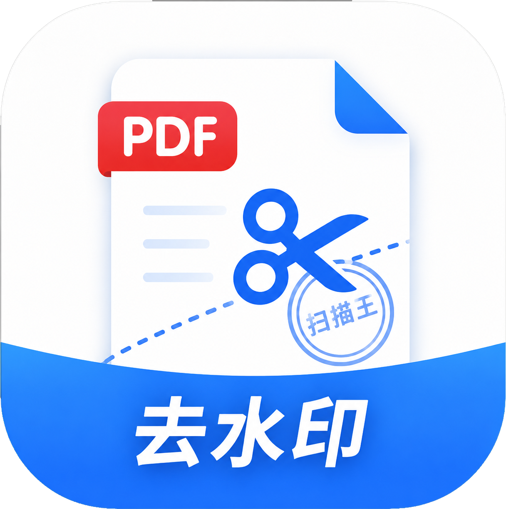

# 夸克去水印 - Android 版

<p align="center">
  
</p>

去除夸克扫描王 PDF 中的水印，纯本地处理，无需联网。

> **本项目唯一的交付形态是 Android 应用。**
> 仓库中的 Python 桌面版（`master` 早期提交、`legacy/pymupdf` 分支）仅作为最开始的技术验证存档，已冻结、不再维护；
> `feature/wechat-pdf-bot` 为已中止的尝试。所有开发在 `feature/android-apk` 分支进行。

## 功能

- **PDF 去水印**：选择 PDF 文件一键去水印，支持批量处理
- **截图转 PDF**：接收其他应用分享的截图，按机型坐标裁切 A4 区域生成复印件 PDF
- 纯本地处理，不申请网络权限，不上传任何文件
- 结果可保存到本地（`Download/夸克去水印/`）或分享给其他应用
- 单文件直接分享 PDF，多文件自动打包 ZIP（兼容微信、QQ 等不支持多附件分享的应用）

## 使用

### 去水印

1. 打开应用，点击「点击选择 PDF 文件」，可多选
2. 点击「开始去水印」
3. 在结果页查看逐文件状态，然后保存到本地或分享

也可以在文件管理器中长按 PDF → 分享 → 选择本应用，直接导入。

### 截图转 PDF

1. 在 WPS 等应用中打开复印件预览
2. 截图
3. 分享到本应用，自动裁切 A4 区域并生成 PDF

裁切坐标存放在 `app/src/main/assets/crop_config.json`，按 `Build.MODEL` 精确匹配机型，未匹配时回落到 `default`（采用一加 Ace5 至尊版的数据）。

## 机型支持

| 机型 | 型号代码 | 屏幕分辨率 | 状态 |
|---|---|---|---|
| 一加 Ace5 至尊版 | `PLC110` | 1264×2780 | 已验证，同时作为 `default` |
| realme X7 Pro | `RMX2121` | 1080×2400 | 已验证 |
| 小米15 | `24129PN74C` | 1200×2670 | 已配置，待实机验证 |
| 红米 K60 | `23013RK75C` | 1220×2712 | **数据存疑，待重测** |

红米 K60 的左右边距为 42/176，明显不对称，疑似 `left` 偏小，暂未修正，详见 `crop_config.json` 中的 `_备注`。

### 新增机型

1. 取型号代码：`adb shell getprop ro.product.model`（必须用设备上报值，不要按市场名推测）
2. 记录屏幕分辨率：`adb shell wm size`，确认系统「屏幕分辨率」设置与之一致
3. 在该机型上打开 WPS 复印件预览并截图，用 `adb exec-out screencap -p > 机型.png` 取原图（不要用聊天软件转发过的压缩图）
4. 量出 A4 白纸区域的 `left` / `top` / `width` / `height`（单位 px）
5. 校验 `width ÷ height ≈ 0.707`（A4 宽高比），偏差超过 2% 说明取点有误
6. 写入 `crop_config.json` 的 `devices`，升版本号后重新打包

注意：系统的「显示大小」「字体大小」「导航方式」都会改变 WPS 顶部工具栏高度，进而影响 `top`。测量时请保持日常使用的设置。

## 技术方案

| 项 | 选型 |
|---|---|
| 语言 | Kotlin 1.9.20 |
| UI | Jetpack Compose + Material3（BOM 2023.10.01） |
| PDF 处理 | iText 7.2.5 |
| 构建 | Gradle 8.3 / AGP 8.2.0 |
| 最低 / 目标 SDK | 26 (Android 8.0) / 34 (Android 14) |

水印移除原理：遍历 PDF 页面内容流，正则匹配夸克水印指令 `q ... cm /QuarkX2 Do Q` 并移除。

## 构建

```bash
# 推荐：检测代码变更、自动递增版本号，然后打包 Release
python build.py

# 手动方式
./gradlew assembleRelease
./gradlew test
```

产物路径：`app/build/outputs/apk/release/夸克去水印_v{version}-release.apk`

**版本规则**：代码有变更时必须同时递增 `app/build.gradle.kts` 中的 `appVersionName` 与 `versionCode`；仅重新打包则版本号不变。

## 版本与发布

| 项目 | 状态 |
|---|---|
| 源码版本 | **v2.0.1**（versionCode 23），已加入小米15 适配，尚未打包 |
| 最新发布 | **v2.0.0** → [下载 APK](../../releases/download/v2.0.0/quark-watermark-v2.0.0-release.apk) |

历史版本见 [Releases](../../releases)。

Android 线自 **2.0.0** 起号：`v1.0.0`～`v1.4.1` 这些 tag 属于早期的桌面版技术验证，与 Android 版没有版本延续关系。

## 环境要求

- JDK 17（AGP 8.2.0 的硬性要求）
- Android SDK：路径写入 `local.properties` 的 `sdk.dir`，需包含 `platforms;android-34`、`build-tools;34.0.0`、`platform-tools`
- 访问 Maven Central 等境外源需要代理，配置见 `CLAUDE.md`

## 项目结构

```
app/src/main/java/com/quark/watermark/
├── core/WatermarkRemover.kt    # 水印移除核心逻辑（iText 7）
├── ui/HomeScreen.kt            # 首页：文件选择、列表、进度
├── ui/ResultScreen.kt          # 结果页：统计、保存、分享
├── ui/theme/                   # Material3 主题与配色
├── util/FileUtils.kt           # 保存、分享、ZIP 打包
├── util/ImageToPdfUtil.kt      # 截图裁切 A4 并转 PDF
└── MainActivity.kt             # 入口与流程编排

app/src/main/assets/crop_config.json   # 机型裁切坐标
```
